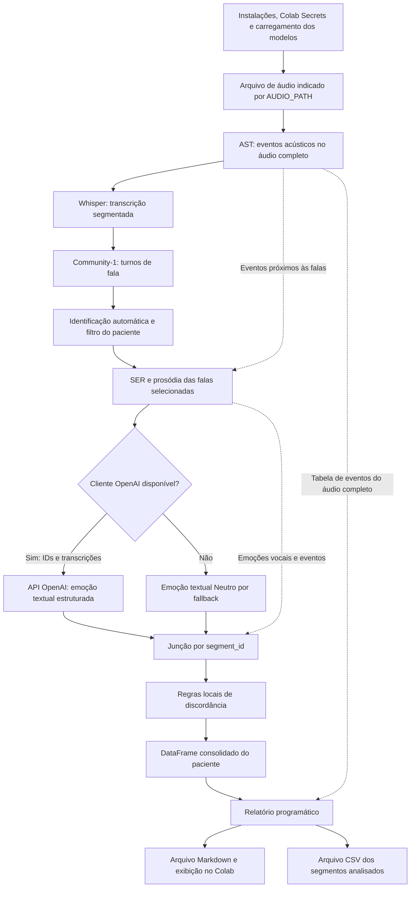

# Análise de áudio clínico — Notebook

Guia de execução do arquivo **`notebook_exemplo.ipynb`** no Google Colab.
Este documento descreve exclusivamente o notebook e seus resultados experimentais.

## Objetivo

Analisar uma gravação de consulta médica para identificar eventos acústicos não verbais,
transcrever a conversa, selecionar as falas do paciente e comparar as emoções estimadas
pela voz e pelo conteúdo textual. O resultado é apresentado em tabelas e em um relatório
Markdown, acompanhado de um CSV com os segmentos analisados.

## Etapas e modelos

| Etapa | Implementação |
|---|---|
| Leitura do áudio | `librosa`, conversão para mono e reamostragem a 16 kHz |
| Eventos acústicos | AST `MIT/ast-finetuned-audioset-10-10-0.4593` |
| Transcrição local | Whisper `base`, com idioma inglês por padrão |
| Diarização | `pyannote/speaker-diarization-community-1` |
| Seleção do paciente | Palavras-chave na transcrição e sobreposição temporal com os turnos de fala |
| Emoção vocal | `ehcalabres/wav2vec2-lg-xlsr-en-speech-emotion-recognition`, três melhores rótulos |
| Prosódia | Pitch médio, desvio padrão do pitch e energia RMS, extraídos com `librosa` |
| Emoção textual | OpenAI `gpt-4o-mini`, com resposta estruturada por Pydantic |
| Discordâncias e relatório | Regras locais em Python e exportação com pandas |

AST, Whisper e diarização processam o áudio completo. A análise vocal e textual é feita
somente sobre os segmentos atribuídos automaticamente ao paciente.

## Arquitetura do notebook

O notebook utiliza execução sequencial em uma sessão Python do Google Colab. As primeiras
células instalam dependências, obtêm credenciais e carregam os modelos; as seguintes definem
as funções de análise. A última célula coordena o processamento e grava os resultados.
Modelos, cliente OpenAI e configurações permanecem em variáveis da sessão.



As setas contínuas indicam a sequência principal; as pontilhadas mostram dados aproveitados
em etapas posteriores. O áudio é lido a partir do caminho informado nas funções que precisam
dele. AST e análise vocal usam `librosa` para leitura em mono a 16 kHz; Whisper e diarização
recebem o caminho do arquivo. O processamento usa CPU ou GPU conforme a disponibilidade de CUDA.

| Componente | Função ou objeto | Responsabilidade |
|---|---|---|
| Configuração e credenciais | `userdata`, `DEVICE`, `TORCH_DEVICE`, `SAMPLE_RATE`, `client` | Obter os segredos do Colab e configurar a execução |
| Detecção de eventos | `ast_classifier`, `detect_clinical_non_verbal_sounds` | Percorrer janelas do áudio e consolidar eventos acústicos |
| Transcrição | `whisper_model`, `transcribe_clinical_audio` | Gerar IDs, tempos e texto dos segmentos |
| Diarização | `diarization_pipeline`, `run_real_diarization` | Obter os turnos e os identificadores de falantes no áudio completo |
| Seleção do paciente | `get_patient_speaker_id_acoustically`, `filter_patient_segments` | Inferir o papel do falante e selecionar os segmentos por sobreposição temporal |
| Voz e prosódia | `ser_pipeline`, `analyze_voice_emotions`, `extract_prosodic_features` | Classificar emoções vocais, calcular pitch/RMS e associar eventos próximos |
| Contrato textual | `SegmentTextEmotion`, `ConsultationTextEmotions` | Definir a resposta estruturada esperada da análise textual |
| Análise textual | `analyze_text_emotion_with_openai` | Enviar apenas IDs e transcrições ou atribuir Neutro sem cliente |
| Fusão e regras | `run_text_and_discordance_analysis`, `calculate_discordance_locally` | Juntar emoções por ID e calcular níveis e explicações localmente |
| Exportação | `generate_clinical_discordance_report` | Gerar Markdown e CSV a partir das tabelas calculadas |

O Hugging Face fornece os modelos de áudio, cuja inferência ocorre no ambiente do Colab.
A chamada OpenAI é a etapa remota de análise textual: não recebe o áudio, os scores vocais
ou os eventos detectados. O relatório é montado por código Python, sem geração de texto por LLM.

Os dados intermediários ficam em listas e DataFrames na memória da sessão. Os resultados
finais são gravados no sistema de arquivos do ambiente; não há banco de dados, servidor de
aplicação ou fila de processamento. A conclusão do fluxo depende das etapas anteriores:
erros de leitura, diarização, modelos ou chamadas à API podem interromper a execução.

## Pré-requisitos

- Conta Google com acesso ao Colab e conexão à internet para instalar bibliotecas e baixar modelos.
- Conta Hugging Face, token de acesso e aceite dos termos do modelo Community-1.
- Chave OpenAI com acesso e saldo/quota para o modelo configurado, caso a análise textual seja utilizada.
- Gravação autorizada de consulta médica, preferencialmente em WAV.

O notebook detecta CUDA automaticamente. GPU é recomendada para reduzir o tempo de execução;
CPU também é selecionada quando CUDA não está disponível. A duração do áudio e os modelos
carregados podem exigir bastante memória.

## Execução no Google Colab

1. Abra o arquivo `.ipynb` no Colab. Se desejar usar GPU, selecione-a em **Ambiente de execução → Alterar tipo de ambiente de execução**.
2. No painel **Secrets**, adicione `HF_TOKEN` e `OPENAI_API_KEY` e habilite o acesso pelo notebook.
3. Envie seu áudio pelo painel **Arquivos**. O caminho padrão esperado é `/content/START_VIDEO_RECORDING_ky56r.wav`.
4. Execute as células na ordem em que aparecem, começando pelas instalações com `pip`.
5. Antes de executar a última célula, ajuste `AUDIO_PATH` para o arquivo enviado.
6. Execute a última célula, acompanhe as etapas e confira as tabelas e o relatório exibido.
7. Baixe os arquivos gerados pelo painel **Arquivos** antes de encerrar a sessão.

Configuração de entrada na última célula:

```python
AUDIO_PATH = Path("/content/START_VIDEO_RECORDING_ky56r.wav")
```

O áudio não é incluído automaticamente. Se o caminho não existir, a execução lança
`FileNotFoundError`. Apesar da descrição introdutória sobre áudio simulado, o código atual
não implementa sua geração automática.

As células de instalação incluem `pyannote.audio`, `openai-whisper`, `transformers`,
`torch`, `torchaudio`, `librosa`, `soundfile`, `openai`, `pydantic`, `pandas`, `numpy`,
`matplotlib`, `seaborn`, `gTTS`, `pydub` e `python-dotenv`. Nem todos esses pacotes são
utilizados pelo fluxo final. As versões não estão fixadas nessas células.

## Credenciais e parâmetros

| Configuração | Padrão e comportamento |
|---|---|
| `HF_TOKEN` | Lido diretamente por `userdata.get("HF_TOKEN")`; necessário para carregar a diarização |
| `OPENAI_API_KEY` | Lida por `userdata.get("OPENAI_API_KEY")`; se a inicialização do cliente falhar, `client` recebe `None` |
| `OPENAI_MODEL` | `gpt-4o-mini` |
| `WHISPER_MODEL_SIZE` | `base` |
| `SAMPLE_RATE` | `16000` |
| Idioma da transcrição | `en`, padrão de `transcribe_clinical_audio` |

Embora o notebook carregue `.env`, a inicialização atual dos clientes usa o **Colab Secrets**.
Definir apenas variáveis em `.env` não substitui essas leituras. A execução fora do Colab
exige adaptar também o import de `google.colab.userdata` e a obtenção das credenciais.

Para transcrever áudio em português, altere a chamada na última célula:

```python
transcribed_segments = transcribe_clinical_audio(AUDIO_PATH, language="pt")
```

Ao mudar parâmetros de modelo, execute novamente as células que definem as funções e
carregam os modelos, além da célula final, para evitar reutilizar objetos antigos da sessão.

## Seleção do paciente e eventos acústicos

A seleção procura palavras como `doctor`, `robot`, `doutor`, `bom dia`, `sentido` e
`consulta`, associa o segmento ao turno com maior sobreposição individual e identifica
outro falante como paciente. Sem correspondência, escolhe o falante com **menor duração
acumulada**; sem turnos, usa `SPEAKER_01`. Essa heurística pode atribuir os papéis incorretamente.

O fluxo final chama `run_real_diarization`. A função auxiliar `run_diarization`, que fixa
dois falantes, não é utilizada nessa execução.

O AST usa janelas de **1,2 s**, passo de **0,6 s**, limiar de score **0,12** e RMS mínimo
**0,015**. Seleciona o primeiro evento elegível entre os oito rótulos retornados e funde
detecções consecutivas da mesma categoria com intervalo de até **0,35 s**. Entre as categorias
estão tosse, pigarro, espirro, suspiro, fungada, choro e respiração ofegante.

Eventos que intersectam a fala expandida em **2,5 s antes e depois** são associados ao
segmento. Eles podem ter sido produzidos por outro participante. A voz é analisada no
segmento completo, com preenchimento por zeros se o trecho tiver menos de **0,2 s**.

## Emoção textual e discordâncias

A OpenAI recebe apenas `segment_id` e `transcricao`, em uma chamada com temperatura zero.
Sua resposta contém a emoção textual por segmento. A identificação do paciente, a
comparação com a voz e a redação do relatório são locais.

Sem cliente OpenAI, o código atribui **Neutro** a cada segmento. Esse resultado é um
fallback, não uma classificação semântica realizada. Falhas de chamada com cliente ativo
não são tratadas por esse fallback e podem interromper a execução.

| Nível | Regra local |
|---|---|
| Alta | Polaridades opostas entre texto e voz, com score vocal maior que 0,6 |
| Moderada | Polaridades opostas, com score vocal menor ou igual a 0,6 |
| Leve | Sem oposição direta, texto positivo/neutro e presença de evento próximo |
| Nenhuma | Demais casos |

A oposição direta tem prioridade. As polaridades são identificadas por substrings em
minúsculas, e Neutro integra o grupo positivo para essas regras. O score vocal é arredondado
a três casas antes da comparação; score zero não exclui um segmento da regra Moderada.
O percentual do relatório usa todos os segmentos selecionados do paciente.

## Arquivos gerados

| Arquivo | Conteúdo |
|---|---|
| `relatorio_discordancias_clinicas.md` | Resumo quantitativo, eventos acústicos, comparação texto/voz e detalhamento das discordâncias |
| `analise_segmentos_clinicos.csv` | Tempos, transcrição, emoções primária/secundária, scores, pitch, RMS, eventos próximos e resultado das regras |

Os arquivos são gravados no diretório de trabalho da sessão e podem ser sobrescritos em
uma nova execução. O relatório também é exibido como Markdown. O fluxo final atual não
gera um arquivo de gráfico ou uma linha do tempo, apesar da menção introdutória a visualizações.

## Limitações e resolução de problemas

- **Áudio não encontrado:** confira o upload e ajuste `AUDIO_PATH` antes da última célula.
- **Acesso à diarização:** confira `HF_TOKEN`, a permissão de acesso pelo notebook e o aceite dos termos do Community-1. O fluxo depende dessa etapa.
- **Erro OpenAI:** confira chave, quota e acesso ao modelo. Sem cliente, os rótulos Neutro devem ser interpretados como fallback.
- **Avisos de pesos novos ou ignorados no SER:** verifique a compatibilidade entre o checkpoint e a arquitetura carregada. As auditorias registradas encontraram divergências entre carregamentos; a reprodutibilidade integral permanece não comprovada.
- **Nenhuma fala selecionada:** revise a transcrição e a diarização. O fluxo atual pode falhar ao montar tabelas vazias, pois espera segmentos do paciente.
- **Variação entre execuções:** registre versões das bibliotecas, revisões dos modelos, hardware, idioma e parâmetros. As instalações sem versões fixas e as respostas do provedor limitam a reprodução exata.

As emoções e discordâncias são estimativas experimentais. Scores não representam certeza
clínica, e as regras não comprovam diagnóstico, estado emocional ou ocultação de sintomas.
Utilize gravações autorizadas: a etapa OpenAI envia a transcrição do paciente a um serviço
externo. Revise transcrições, saídas salvas e credenciais antes de compartilhar o notebook.


## Autor

### Grupo 95:
```bash
Gabriel Paoliello RM370704 - ga.paoliello@gmail.com
Pedro Rogala RM372338 - pedrorogala@gmail.com
Sandro Felipe RM372111 - kleyguerth@gmail.com
Rafaella Reis RM373710 - rafaelareis20@gmail.com
Wisley Siqueira RM374052 - dev.wisleysiqueira@gmail.com
```

Turma: 9IADT

Curso: PosTech - Inteligência Artificial para Devs

Instituição: FIAP

