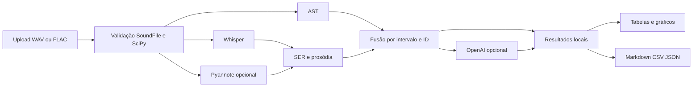

# Arquitetura e decisões

`AnalysisPipeline` depende de protocolos, permitindo doubles de áudio e semântica nos testes. Contratos Pydantic tornam explícitos intervalos e scores. Falhas essenciais de áudio/modelos interrompem o processamento, com mensagem por etapa para o usuário. Falhas opcionais da análise semântica geram aviso e mantêm os dados locais; não são convertidas em “ausência de discordância”. Falhas da diarização também geram aviso e permitem continuar com falantes não identificados, registrando a indisponibilidade nos metadados; nenhum papel ou turno é inventado.

Streamlit mantém resultados por sessão. `cache_resource` guarda serviços e pesos, não resultados de consultas. Um lock serializa inferência por serviço compartilhado para evitar execução concorrente no mesmo modelo. Não há fila distribuída ou garantia de desempenho para múltiplos usuários.

Upload e configuração formam um fingerprint para invalidar resultados antigos quando mudam. SoundFile lê WAV/FLAC diretamente de bytes; o formato real deve corresponder à extensão. Duração, canais e taxa são limitados antes da decodificação completa. Blocos são convertidos para mono e SciPy faz reamostragem polifásica com filtro antialiasing para 16 kHz. Não há executáveis externos ou arquivos temporários neste fluxo. Whisper e Pyannote recebem arrays/tensores em memória. A aplicação não registra payloads ou exceções da API que possam conter dados clínicos.

A diarização identifica IDs acústicos; ela não reconhece papéis. A associação de transcrição a um falante usa a soma das interseções; empates ficam ambíguos. Não recortamos automaticamente todos os segmentos como “paciente”. Eventos próximos em ±2,5s são associação temporal, não prova de autoria ou causalidade.

A análise semântica usa `responses.parse`, `store=False` e lotes de até 15 segmentos. Os IDs retornados precisam corresponder exatamente aos enviados. A entrada é tratada como dado não confiável no prompt. `store=False` não constitui garantia de ausência de retenção operacional pelo provedor; use somente dados autorizados e compatíveis com as regras da instituição.

O aplicativo é um protótipo local. Transformá-lo em sistema clínico exigiria validação de finalidade, políticas institucionais, autenticação, isolamento, TLS, controles de acesso, governança dos dados e avaliação de segurança próprios do ambiente de implantação.
