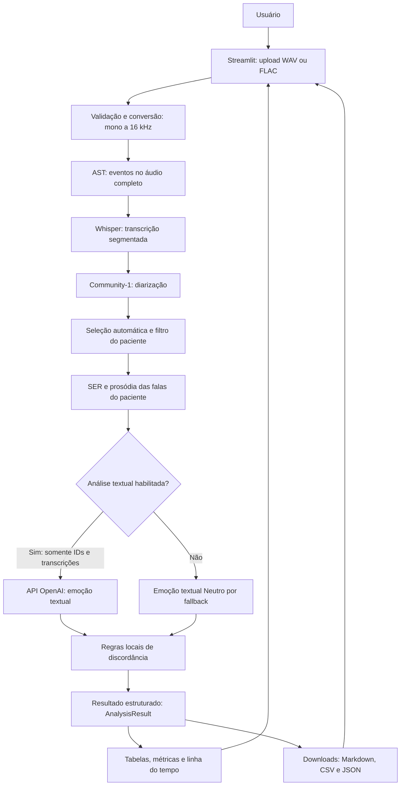

# Tech Challenge 4 G95 — áudio e texto

Aplicação Streamlit para análise de áudio e texto de consultas, com transcrição,
diarização, identificação de eventos acústicos e comparação de emoções vocais e textuais.

## Dataset de Áudio Selecionado (Consulta Médica)

Para atender aos requisitos de diálogo de consulta médica e de manifestações patológicas da fala humana real, sem recorrer a síntese de voz, utilizamos o **MeDial-Speech (anamnese clínica)**.

- **Nome do Dataset e Instituição Responsável:**
  **Componente A (Consulta Médica / Anamnese):** MeDial-Speech Dataset, mantido no repositório Hugging Face Datasets (`hcuayahu/MeDial-Speech`) por pesquisadores em IA biomédica.
- **Link Oficial do Repositório / Download Direto:**
  **MeDial-Speech:** [Repositório Hugging Face](https://huggingface.co/datasets/hcuayahu/MeDial-Speech) (Licença CC BY-NC 4.0, acesso público e imediato).
- **Conteúdo Específico da Fala (anamnese, termos médicos ditos, sintomas presentes como fadiga ou disartria):**
  **Consultas e Anamneses (MeDial-Speech):** Gravações em áudio humano real no formato `.wav` contendo diálogos entre médicos e pacientes. Os diálogos abrangem a coleta de dados demográficos, relatos de queixas principais (dificuldade de concentração, insônia, fadiga diurna, desmaios/síncopes, quedas frequentes e tremores finos em mãos), histórico patológico egresso (Ataque Isquêmico Transitório — AIT / TIA e hipertensão), hábitos de vida (consumo de álcool), antecedentes familiares (doença de Alzheimer) e revisão farmacológica (prescrição de Clopidogrel 75mg e Anlodipino 5mg).

## Fluxo da avaliação

1. Ler áudio autorizado como mono a 16 kHz.
2. Detectar eventos não verbais com AST: janela 1,2 s, passo 0,6 s, top 8, limiar 0,12 e RMS mínimo 0,015.
3. Transcrever com Whisper base, em inglês por padrão, preservando IDs e tempos arredondados a duas casas.
4. Diarizar com `pyannote/speaker-diarization-community-1`.
5. Identificar o paciente pela heurística de seleção automática e filtrar suas falas antes de analisar voz e texto.
6. Analisar voz com `ehcalabres/wav2vec2-lg-xlsr-en-speech-emotion-recognition`, top 3, e extrair pitch/RMS do segmento completo.
7. Extrair emoção textual com OpenAI, em uma chamada, usando `gpt-4o-mini` por padrão e temperatura zero.
8. Calcular discordâncias localmente e gerar relatório Markdown e CSV com os campos da análise.

Sem cliente OpenAI, cada segmento recebe **Neutro**, conforme o fallback. Com cliente ativo,
erros da API interrompem a execução; não são convertidos em neutralidade. A diarização é obrigatória:
falhas de acesso/modelo interrompem o fluxo, sem analisar todos os falantes como alternativa.

A heurística usa palavras como `doctor`, `robot`, `doutor`, `bom dia`, `sentido`, `consulta` para
identificar médico/robô e escolher outro falante como paciente. Sem correspondência, usa o falante
com menor duração acumulada; sem turnos, o ID padrão é `SPEAKER_01`. Essa inferência não garante o
papel real. O aplicativo mostra o ID escolhido; não permite trocar por seleção manual de paciente.

## Arquitetura do projeto

A aplicação organiza interface, processamento e integrações em módulos Python. O Streamlit
recebe o arquivo e apresenta os resultados; `AnalysisPipeline` coordena a análise por meio de
adaptadores de áudio e texto, que podem ser substituídos nos testes.



As etapas do processamento real são sequenciais. Os eventos são detectados no áudio completo
e associados às falas por proximidade temporal; voz e texto são analisados apenas para o
paciente selecionado. A diarização é obrigatória. A OpenAI classifica a emoção textual;
o cálculo das discordâncias e a montagem dos relatórios são executados localmente.

| Componente | Responsabilidade |
|---|---|
| `app.py` | Interface Streamlit, autorização do upload, configuração da análise, visualização e downloads |
| `audio.py` | Validação de formato, tamanho e duração; leitura com SoundFile, conversão para mono e reamostragem |
| `pipeline.py` | Orquestração das etapas, filtragem do paciente e construção de `AnalysisResult` |
| `backends.py` | Adaptador `LocalModels`: AST, Whisper, Community-1, SER e extração de prosódia |
| `semantic.py` | Adaptador `OpenAISemantic`: envio de IDs/transcrições e leitura da resposta estruturada |
| `models.py` | Contratos Pydantic para segmentos, turnos, eventos, emoções e resultados |
| `rules.py` e módulo de análise clínica | Heurísticas de seleção, associação de eventos, comparação de emoções e menções por palavras-chave |
| `reports.py` | Preparação de tabelas e exportações Markdown, CSV e JSON |
| `config.py`, `dependencies.py` e `errors.py` | Configurações, diagnóstico de dependências e mensagens de erro por etapa |
| `demo.py` | Dados fictícios para explorar a interface sem carregar modelos ou chamar APIs |
| `verification.py`, `tests/` e `scripts/` | Critérios de auditoria, testes automatizados e verificações explícitas de inferência real |

Os módulos de serviço ficam em `src/clinical_audio/`. Os modelos locais são carregados sob
demanda e reutilizados em cache; cada pipeline compartilhado possui um lock para serializar
as análises. Uploads e resultados permanecem na memória da sessão. Alterar o arquivo, idioma,
modelo Whisper ou opção OpenAI invalida o resultado anterior.

O Hugging Face fornece acesso e download de modelos; a inferência de áudio ocorre no ambiente
da aplicação, em CPU ou GPU. Quando habilitada, a integração OpenAI envia somente IDs e
transcrições. A arquitetura atual não utiliza banco de dados nem fila de processamento.
Falhas de modelos ou da API ativa interrompem a análise e são apresentadas na interface.

Consulte [a documentação de arquitetura](docs/arquitetura.md) para detalhes adicionais.

## Instalação e execução

Use preferencialmente Python 3.11 para a pilha de IA. O pacote declara Python 3.11–3.13;
a suíte local é executada com Python 3.13.12. Instale na raiz do projeto:

```powershell
py -3.11 -m venv .venv
.\.venv\Scripts\python.exe -m pip install --upgrade pip
.\.venv\Scripts\python.exe -m pip install -r requirements.txt
if (-not (Test-Path .env)) { Copy-Item .env.example .env }
```

Configure `.env` sem publicar as credenciais:

```dotenv
HF_TOKEN=seu-token
OPENAI_API_KEY=sua-chave
OPENAI_MODEL=gpt-4o-mini
WHISPER_MODEL=base
AUDIO_LANGUAGE=en
```

O token HF deve ter acesso ao Community-1, com aceite dos termos na conta correspondente.
OpenAI exige quota e acesso ao modelo e pode gerar cobrança. Sem chave, deixe a opção OpenAI
desmarcada para usar o fallback Neutro. Com chave configurada, a opção inicia marcada.
A interface inicia em inglês; selecione outro idioma apenas se desejar alterar a configuração do
experimento. Use Whisper base e gpt-4o-mini para os padrões.

```powershell
.\.venv\Scripts\python.exe -m streamlit run app.py --server.address 127.0.0.1
```

Abra [a aplicação local](http://localhost:8501). Envie WAV ou FLAC de até 25 MB, 10 minutos,
8 canais e 192 kHz; confirme a autorização e clique **Analisar arquivo**. O áudio é lido em memória
com SoundFile, convertido para mono e reamostrado com librosa. Não é necessário FFmpeg
para esses uploads. O suporte da interface permanece restrito a WAV/FLAC.

Os modelos são baixados na primeira utilização. CPU é suportada, mas pode ser lenta; uma GPU CUDA
compatível é detectada automaticamente. A análise de segmentos completos pode consumir mais tempo
e memória que a versão anterior, que limitava a voz a 20 segundos. Não existe mais esse corte.

Nenhum pacote novo foi acrescentado para esta correção de fidelidade. `requirements.txt` já inclui
Whisper, Transformers, librosa, Pyannote, OpenAI, interface e ferramentas de desenvolvimento.
`wheel>=0.45,<1` também já está declarado. Se ausente na instalação local, instale:

```powershell
.\.venv\Scripts\python.exe -m pip install "wheel>=0.45,<1"
```

Linux/macOS: crie uma venv com `python3.11 -m venv .venv`, ative-a e use os mesmos comandos
`python -m pip install -r requirements.txt` e `python -m streamlit run app.py`.

## Resultados

O AST escolhe o primeiro rótulo elegível entre os oito retornados, um evento por janela.
A fusão compara apenas com o último evento; não inclui uma janela final incompleta se já houver
janelas completas. Eventos a ±2,5 s são associados às falas.

| Nível | Regra de discordância |
|---|---|
| Alta | Polaridades opostas entre texto e voz, score de voz > 0,6 |
| Moderada | Polaridades opostas, score de voz <= 0,6, inclusive zero |
| Leve | Sem oposição direta, texto positivo/neutro e evento próximo |
| Nenhuma | Demais casos, inclusive emoções fora das polaridades previstas |

O score de voz é arredondado a três casas antes de aplicar a regra. Não há guarda adicional de
Não avaliada no cálculo. O percentual de discordâncias usa o total de segmentos do paciente.
Nas explicações, termos como “contradizem” são saídas da heurística e não
comprovam estado emocional, ocultação de sintomas ou diagnóstico.

A aba de relatórios disponibiliza `relatorio_discordancias_clinicas.md` e
`analise_segmentos_clinicos.csv`, com colunas em português como `segment_id`, `transcricao`,
`emocao_discurso_texto`, `nivel_discordancia`, `ha_discordancia` e `explicacao_clinica`.
JSON, CSV complementar, linha do tempo e menções por palavras-chave são recursos adicionais.
Todos os resultados do fluxo real correspondem somente ao paciente selecionado; os eventos são
detectados no áudio completo. Os arquivos ficam disponíveis para download em memória.

A demonstração offline é explicitamente fictícia. Não analisa uploads e não substitui a execução
com modelos e credenciais. **Limpar resultados** remove o resultado da sessão.

## Organização e validação

- `app.py`: interface, uploads e downloads.
- `src/clinical_audio/backends.py`: modelos de áudio e prosódia.
- `src/clinical_audio/pipeline.py`: ordem das etapas e filtragem prévia do paciente.
- Módulo de análise clínica: heurísticas de seleção, comparação e relatório.
- `src/clinical_audio/semantic.py`: chamada Chat Completions estruturada, sem lotes.
- `src/clinical_audio/rules.py`: adaptação dos contratos às regras locais.
- `src/clinical_audio/reports.py`: colunas e exportações, mais formatos complementares.
- Testes de comparação funcional: verificação de regras, tabelas e relatórios com entradas controladas.
- `src/clinical_audio/verification.py` e `tests/test_verification.py`: critérios e regressões da aprovação de auditorias reais.
- `scripts/verify_real_parity.py` e `scripts/verify_audio_checkpoint.py`: auditorias explícitas de modelos reais, separadas de pytest.
- `scripts/fixtures/analysis_reference.json`: funções e constantes independentes usadas pelos testes de comparação e pelas auditorias.

```powershell
.\.venv\Scripts\python.exe -m ruff check .
.\.venv\Scripts\python.exe -m ruff format --check .
.\.venv\Scripts\python.exe -m pytest
.\.venv\Scripts\python.exe -m build
```

A verificação local desta revisão aprovou **199 testes**, com **99,29% de cobertura**, além de Ruff lint e formatação.
Os testes usam doubles para modelos e API e verificam regras com entradas controladas, sem rodar instalações ou downloads. Isso verifica regras e integração,
sem demonstrar qualidade preditiva ou igualdade de inferência entre ambientes.
Consulte [a matriz de equivalência, testes e pendências](docs/equivalencia-e-testes.md),
[a verificação](docs/verificacao.md), [o fluxo e as regras](docs/fluxo-e-regras.md),
[a arquitetura](docs/arquitetura.md), [o escopo](docs/escopo.md) e [o plano de avaliação](docs/avaliacao.md).

## Resultado da auditoria com o áudio real

A comparação com `START_VIDEO_RECORDING_ky56r.wav` confirmou áudio, 12 segmentos Whisper e
4 eventos AST iguais. A equivalência integral ainda **não foi comprovada**: a primeira tentativa de diarização falhou
com RuntimeError (uma repetição isolada concluiu com 11 turnos), e o SER original apresentou pesos
novos e previsões diferentes entre dois carregamentos independentes. A OpenAI não foi chamada
na auditoria integral interrompida pela primeira falha de diarização. Consulte [o relatório da inferência real](docs/inferencia-real.md).

O novo arquivo `START_VIDEO_RECORDING_4r.wav` (418,816 s) também foi verificado no pré-requisito
SER: os três trechos reais comparados tiveram emoções diferentes entre carregamentos, embora
pré-processamento e prosódia coincidissem. As demais etapas não foram executadas nesse arquivo
após a divergência. Veja [a auditoria do áudio 4r](docs/inferencia-real-4r.md).

## Limites de execução

O checkpoint SER original foi restaurado por fidelidade. Uma verificação histórica neste ambiente
identificou avisos de pesos ignorados/novos ao carregá-lo com Transformers. Esta correção não troca
silenciosamente o checkpoint por outro: a auditoria real confirmou novamente pesos novos e divergência entre carregamentos; esse ponto precisa ser resolvido no ambiente da avaliação.
O SER é treinado em inglês; suas categorias não comprovam emoções clínicas em português.

Usar os mesmos modelos não garante saídas numericamente idênticas: versões, revisões de pesos,
hardware, reamostragem e respostas do provedor precisam ser controlados. Mantenha as configurações
e registre o ambiente ao comparar execuções.

Uploads/resultados ficam em memória; pesos são cacheados pelas bibliotecas. A transcrição enviada
à OpenAI pode conter dados pessoais. Revise outputs e relatórios antes de publicá-los.
Não há autenticação, TLS ou plataforma de produção clínica nesta entrega.

## CI/CD e container

O workflow `.github/workflows/ci-cd.yml` executa lint, formatação, pytest e build em Python
3.11–3.13, instala a variante leve com `.[dev]` e testa o endpoint HTTP do container.
Tags `v*` publicam imagem leve no GHCR; não há implantação automática em servidor.
O workflow remoto e o Docker precisam ser verificados no ambiente da equipe.

```bash
docker build -t g95:demo .
docker run --rm -p 127.0.0.1:8501:8501 g95:demo
docker build --build-arg INSTALL_ML=true -t g95:ml .
docker run --rm -p 127.0.0.1:8501:8501 --env-file .env g95:ml
```

A imagem leve executa a demonstração. A variante ML inclui os modelos/diarização como dependências;
pesos ainda precisam ser baixados. O container roda sem privilégios e inclui libsndfile.


## Autor

### Grupo 95:
```bash
Gabriel Paoliello RM370704 - ga.paoliello@gmail.com
Pedro Rogala RM372338 - pedrorogala@gmail.com
Sandro Felipe RM372111 - kleyguerth@gmail.com
Rafaella Reis RM373710 - rafaelareis20@gmail.com
Wisley Siqueira RM374052 - dev.wisleysiqueira@gmail.com
```

Turma: 9IADT

Curso: PosTech - Inteligência Artificial para Devs

Instituição: FIAP
