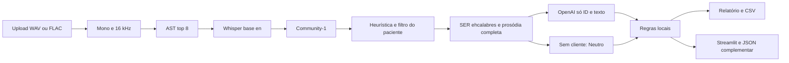

# Arquitetura

`AnalysisPipeline` usa adaptadores injetáveis. A diarização é obrigatória. O filtro de paciente
ocorre antes de SER e OpenAI; somente os eventos são analisados no áudio completo. A associação
usa o maior turno individual de sobreposição, sem soma por falante.
A seleção de papéis usa palavras-chave e fallback por menor duração, sem seleção manual posterior.

O módulo de análise clínica implementa seleção, filtragem, discordância e relatório. `rules.py` adapta os modelos
Pydantic a essas funções. O relatório retorna string em vez de gravar no servidor. `reports.py`
produz CSV com os campos da análise e mantém exportações complementares.

O adaptador textual usa uma chamada `client.beta.chat.completions.parse`, temperatura zero,
modelo configurável e schema `ConsultationTextEmotions`. A resposta é convertida para o contrato
interno; a junção usa o primeiro resultado por ID, ou Neutro se ausente. Sem cliente, todos recebem
Neutro. Falhas de cliente ativo ou modelos propagam erro, sem resultado parcial apresentado na UI.

Streamlit mantém uploads/resultados em memória da sessão e usa cache de serviços/modelos.
Um lock serializa cada pipeline compartilhado. Fingerprint invalida resultados quando arquivo,
idioma, Whisper ou opção OpenAI mudam. A interface inicia em inglês; diarização não pode ser
removida do fluxo real. A demonstração não chama modelos nem API.

SoundFile verifica formato, tamanho, canais e duração antes de ler. A interface usa
`decode_upload` com reamostragem por librosa. O caminho SciPy
permanece como utilitário testado, mas não é usado nos uploads do fluxo fiel.

Veja [o detalhamento do fluxo](fluxo-e-regras.md) e [o registro de verificação](verificacao.md).

## Auditoria separada da inferência

`verification.py` contém apenas o critério de aprovação dos relatórios de auditoria. Não muda
o modelo, o pipeline ou a resposta da interface. Os scripts em `scripts/` usam esse critério
para impedir aprovação com etapas incompletas, pesos novos/ignorados ou sem OpenAI comparada.
A integração atual ainda usa o carregador SER configurado, com o problema real documentado.
Veja [a matriz de critérios, testes e pendências](equivalencia-e-testes.md).
